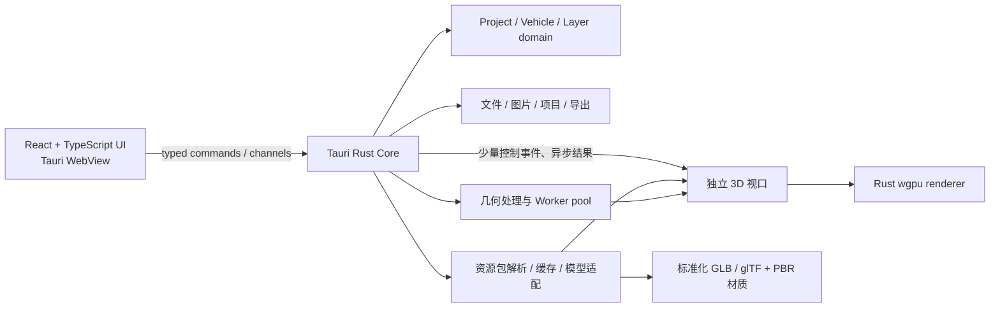

# Rust + Tauri + React 前端与 3D 重构方案

日期：2026-11-09（香港时间）
适用范围：`L:\SU7\痛车编辑器-下一版`，现有 SU7 编辑器向新主框架迁移
方案性质：架构提案与有前提的性能目标；尚未实现原型，不构成性能保证

阶段性细化文档已建立：[设计文档总览](./重构设计/README.md)。命令所有权、工作目录与便携保存语义、任务并发和性能计时口径以其中公共附录的 Draft 0.1 为当前评审版本；性能预测仍需原型验证。

## 1. 目标与关键决定

重建应用外壳为 Tauri 2 + Rust 主进程，产品 UI 使用 React + TypeScript。React 管理工作区、属性面板、图层/素材列表、弹窗和可访问性；Rust 管理工程、资源、文件对话框、导入/导出、图片处理、几何任务和渲染资源。取消当前 Electron + Rust localhost HTTP 的进程链，应用内操作通过明确的 Tauri command/channel 契约完成。

新 3D 视口不再加载小米 iframe、配置器页面、Service Worker 或 `patches.rs` 注入钩子。它根据通用车辆资源清单直接载入经过授权并转换的网格、贴图、材质、UV 和部件标签。

推荐技术方向为 **Rust 领域核心 + Rust/wgpu 视口 + React/Tauri 桌面外壳**。但原生 wgpu 视口与 Tauri WebView 同窗叠放、resize、DPI、焦点和指针路由有平台集成风险，须先做可运行的垂直切片。若原生表面无法稳定嵌入，备选为 React WebView 中运行自有 WebGPU renderer，Rust 仍拥有资源、几何、文件、工程和通用模型协议；在评审这一取舍前，不应承诺“GPU 全由 Rust 绘制”。Tauri Core 负责 Rust API，不会替代 WebView 绘制 React 界面。官方[进程模型](https://v2.tauri.app/concept/process-model/)对此有说明。

### 前置资产门槛

当前 SU7 离线存档 manifest 有 409 个资源条目、约 85.2 MB 索引所计资源；其中 `assets.mi` 约 22.8 MB，另有解密 WASM、Draco decoder 和 Basis transcoder。仓库未发现可直接交给独立渲染器使用的 SU7 GLB/glTF 模型包。配置适配器中的 materialOverrides 是配置业务响应数据，不能当作已经导出的 PBR 贴图材质。

因此不能把“只采用模型与材质”简单等同为改掉 iframe 即可。必须先从拥有使用/转换权限的原始资源提供方取得可独立加载的模型包，或验证获授权的离线转换流程，输出标准化网格和材质，并对比新旧视口的轮廓、颜色、UV 和部件映射。若资产无法合法且稳定地独立解析，独立渲染器的 SU7 迁移会被阻塞；方案不把逆向加密格式作为确定性前提。

## 2. 目标运行架构

图中 Native View 作为优先探索的视口承载方案；Tauri 子窗口/子视图嵌入和窗口合成仍要经过 Windows 原型验证。若用独立顶层窗口，会损害“外壳尽量还原”和拖拽连续性，因此不作为默认交付行为。

### 模块职责建议

| crate / package | 所有权与职责 |
| --- | --- |
| `src-tauri` | Tauri 启动、权限 capabilities、窗口和视口生命周期；不承载编辑领域规则 |
| `domain` | 车型无关的 Project、Layer、AssetRef、Material、SceneTag、变更事务及工程版本迁移；可做纯 Rust 单元测试 |
| `application` | 用例编排：新建/打开/保存、导入素材、图层命令、配置车型、撤销、渲染状态；提供稳定 command DTO |
| `asset_pipeline` | 格式嗅探、安全校验、GLB/glTF 解析、贴图解码、单位/轴系归一化、缓存和资源清理 |
| `vehicle_adapter` | 独立车辆 manifest 与语义部件 ID 映射；按车型适配，不把 SU7 名称写进通用 renderer |
| `geometry` | BVH/射线拾取、部件表面图、邻接、跨缝贴图投影、曲率/距离和 UV 变换；输入输出为无 UI 的数据结构 |
| `renderer_wgpu` | 场景、相机、PBR、环境/灯光、网格批次、材质/纹理上传、视口 resize、帧调度和设备丢失恢复 |
| `persistence` | 版本化工程、素材二进制包、增量/原子保存、自动保存和旧 `.su7design` 导入 |
| `image_pipeline` | 解码、缩略图、颜色空间、ICC/EXIF 策略、尺寸预算；按任务池并行 |
| `export` | SVG/PDF/PNG/UV/工程容器；高分辨率输出不阻塞交互 |
| `src/ui` | React 页面与组件；Zustand/Redux 等只选一个 UI 状态工具，工程权威状态保留在 Rust |
| `src/bridge` | Tauri invoke、事件/channel、输入 schema 和 TS 类型；生成或校验 DTO |

渲染线程不把高频鼠标移动逐点往返 JSON IPC。视口局部处理相机 orbit、pan、zoom、hover、raycast 与临时预览；仅把选择、手势开始/提交、属性修改、资源载入和错误等语义状态发给 Rust/UI。大量二进制结果用响应字节、共享资源/句柄或 channel 分块，不把图像转成 Base64 JSON。Tauri command 会将普通可序列化值转为 JSON；大数据应设计专用二进制传输契约，具体边界与官方依据见[跨阶段契约](./重构设计/附录A-跨阶段数据与并发契约.md)。

所有文件与网络边界由 Rust 主框架拥有：React 不直接 fetch 后端 API，不接触任意系统路径，不自行管理 autosave 文件。Tauri command 执行受限操作，Rust 内部 service 调用本地能力；若产品确实需要联网车型资源，再由 Rust 网络 service 管理来源、缓存、取消、超时和许可提示。当前通过 localhost HTTP 的 `/__api/*`、`/__archive`、车型静态 URL 和 Service Worker 重放逐项迁成命令与资源仓库。Tauri 不要求把每类数据都塞进 command JSON。

## 3. 通用车模和渲染协议

### 车型资源包

定义带 schema/version 的车型包 manifest，至少记录：

- 模型 URI、SHA-256、许可/来源、导入器版本、长度单位与坐标系。
- 场景根节点、mesh、材质及纹理引用；每个 renderer 材质使用 Metallic-Roughness PBR 语义，并明确 sRGB/线性通道。
- 部件语义映射，例如 `body.panel.front_left_door`、可涂装面、碰撞/拾取属性、原始 UV 与所用 UV set。
- 涂装投影配置、网格拓扑版本、邻接/接缝映射和可选 LOD。
- 贴图编码、尺寸/MIP 策略、透明度、法线和 AO 等通道约定。

第一阶段以 glTF 2.0/GLB 作为规范交换格式。外部解码依赖（Draco、KTX2/Basis 等）必须随产品锁定版本和许可；未安装解码器时给可读错误。不要让 `renderer_wgpu` 自行推断部件含义。模型包校验 UV、索引、节点引用和资源体积；导入用户模型时生成诊断报告，缺少部件标签的模型可以展示，但不能伪称具备可靠的车身曲面跨缝编辑。

### 几何与贴花

定义车型无关的 mesh handle 与 semantic part handle。普通贴花和跨缝贴花使用同一领域 layer 数据，由 `geometry` 根据模型表面图生成受约束的覆盖三角形/UV。渲染器接收已验证的 buffer 更新，不负责车型识别和曲面搜索。选中轮廓/控制柄属于 viewport overlay pass，不污染制作导出。

保留现有 SU7 的 wrap 迁移器、真实车辆覆盖用例和独立制作输出来作对照；新格式需要记录 `modelFingerprint`、几何拓扑版本和投影算法版本。模型变化时旧 wrap 要明确重算或提示，不能用过期 triangle index 静默显示。

### 工程格式

工程 v2 使用 manifest + 分块二进制素材（PNG/JPEG/WEBP 或原始编辑源）+ 规范 JSON 文档。React 状态只持有 asset ID 和缩略图句柄，避免在工程 store 复制大 data URL。保存使用增量 dirty set、后台序列化/压缩和临时文件原子替换。旧版 v1 `.su7design` 继续只读导入并迁移，直到对真实存档回归完成；导出 v2 前提供显式版本标记。

## 4. 外壳迁移与交互连续性

以当前页面的工作区分栏、项目首页、素材区、图层列表、属性面板、相机工具、车辆配置状态、设置和导出对话框为 UI 清单。保留信息层级、操作位置、快捷键、深浅色与关键尺寸，用截图逐屏对照；把内层 iframe 的配置器阶段改为自有车型与外观设置面板，不复制小米电商 UI。

先建立 Tauri + Vite + React/TS 的静态 shell，并加载固定 glTF 测试车；交互协议稳定后接入 SU7 转换资产。工作台和视口采用稳定尺寸约束，viewport 可见时由 renderer 明确申请帧；窗口后台、最小化或仅编辑模式暂停不必要渲染。

性能设置拆成 CPU 任务并发、视口渲染比例、贴图预算、抗锯齿和 GPU 设备状态。线程数只影响真正分块并行任务；GPU 关闭或设备丢失时保留 2D 编辑、工程与导出能力，并反馈实际回退状态。

## 5. 性能目标、估算方法与时间范围

### 估算口径

以下**目标是规划区间，不是实测结论**。暂定基准工作负载：Windows x64、1600×1000、显示器 60 Hz、Core Ultra 7 265K / 64 GB RAM / RTX 5080 级参考机；一辆已规范化车辆，目标 0.5–2 百万可见三角形、100–300 draw calls（这两个值尚待读取现有模型实际统计，必须在资产 spike 校准）；100 个图层，其中 10 个曲面图层，4K 素材；单画布拖动以中画质测试。硬件加速必须实际生效，不能只依据设备列表判断。

当前可比的真实记录来自 2026-11-08 `tools/acceptance/performance/verification.json`：旧 Electron 下普通变换事件→下一 rAF P95 0.5 ms，但帧间隔 P95 8.5 ms/max 66.7 ms；跨面变换 P95 37.3 ms，帧间隔 P95 33.3 ms/max 83.3 ms；曲面重算 P95 17.2 ms；4K 导入 3.60 s；保存 0.52 s；模型就绪 3.72 s；Tab 工作集约 1.62 GiB。旧 `curvePanelDrawMs` P95 达 241 ms，但属于制作 Canvas 路径，不是视口单帧性能。它是单机单次场景基线，GPU 记录无法确认 active device。

### 端到端时间目标

| 用户操作 / 指标 | 参考机目标区间 | 低配集显目标区间 | 估算可信度与前提 |
| --- | ---: | ---: | --- |
| Tauri 至项目首页可交互 | 0.25–0.70 s | 0.50–1.30 s | 中；bundle、WebView 启动和主线程初始化，须实测安装后冷/热启动 |
| 冷载入车辆至可 orbit | 1.2–3.0 s | 3.0–7.0 s | 低至中；模型资产需可直接读取，含磁盘、解码、buffer/纹理上传；当前 3.72 s 含旧配置器启动 |
| 再次打开缓存车辆 | 0.4–1.2 s | 0.8–2.5 s | 中；需磁盘资源缓存与 GPU 上传实测，进程重启不保证显存留存 |
| 4K 素材导入至低清预览 | 0.25–0.80 s | 0.8–2.0 s | 低至中；取决于源格式和颜色转换；4K 原图不得为预览强制完整无损拷贝 |
| 普通图层拖动输入→下一显示帧 P95 | 8–16 ms | 12–25 ms | 中；60 Hz 条件下目标主要是单帧内事件处理和合成 |
| 跨曲面贴花拖动 P95 单帧计算 + 渲染 | 10–20 ms | 18–33 ms | 低；包含目标表面查询/预览，不包括高于帧预算的可选后台精确更新 |
| 3D orbit/pan 帧间隔 P95 | 8–16.7 ms | 16.7–33 ms | 低至中；需要统一 renderer、机模复杂度、抗锯齿和显示刷新率 |
| 约 6 MB 工程保存 | 0.08–0.35 s | 0.15–0.70 s | 中；后台序列化 + 本地 NVMe；不等同任意磁盘/压缩等级 |
| 2K 车身贴图/视口 resize 完成 | 0.10–0.50 s | 0.25–1.0 s | 低；和材质数、WebGPU/wgpu 驱动、贴图格式有关 |
| 曲面制作面板全尺寸合成 | 0.05–0.20 s | 0.15–0.60 s | 低；当前旧路径 P95 241 ms，目标需基于离屏渲染或按需输出原型 |

“下一显示帧”仍是端到端近似指标；基准应分别报告 input dispatch、主线程/geometry、GPU submit、present frame，而非把一个 rAF 时间称作像素延迟。若使用 120 Hz 显示器，单帧预算应改为 8.33 ms。

以上目标对热路径可给出有条件的性能预期：从目前 37.3 ms 的跨面交互 P95 降到 10–20 ms 区间（参考机）是**约 1.9–3.7 倍的延迟改善目标**，不是承诺；CPU-only 曲面计算降至 2–8 ms 也只有在几何任务可并行且减少每次拖动的拓扑搜索后才合理。UI 启动可能略快，但 Tauri 对 3D 帧率没有自动加速作用。若用本地标准模型替换旧 iframe，冷模型加载目标约 1.2–3.0 秒；模型转换后包体可能增加或减少，不能仅以 `assets.mi` 22.8 MB 估算标准化资产大小。

### 项目周期估算

以 3–4 名工程师并行（1 名 Rust/渲染、1–2 名前端/桌面、1 名 QA/工具可共享），已有可用且许可明确的模型资产为前提，完整替换核心编辑功能约 **12–20 个日历周**。其中资产解码/窗口嵌入 spike 1–2 周，核心数据与 Tauri shell 2–3 周，通用渲染与车型契约 3–5 周，编辑/历史/导入导出迁移 4–6 周，兼容性/性能/真实车辆验收 2–4 周；区间部分并行。缺少可独立使用的 SU7 资产时，资产管线和授权确认另加 2–8 周或成为阻塞项。小于三人的团队、复用当前全部编辑能力和多车型同步首发，会显著超过此范围。

## 6. 迁移阶段与验收门

### 阶段 0：技术与资产 spike（1–2 周）

- 审核模型/材质使用权、导出路径、来源和许可；盘点 `assets.mi` 管线与每车型资源。
- 分别验证：SU7 标准 mesh/material 可脱离配置器加载；Tauri WebView 与 wgpu native view 的同窗集成、DPI、窗口 resize、输入焦点/拖放。
- 读取当前模型统计：节点/材质数、mesh 数、顶点/三角面、贴图尺寸、GPU 上传字节。
- 生成静态基准模型和场景，用新旧截图、相机位姿及颜色样片比对。
- Gate：没有许可清晰的标准化 SU7 模型就暂停车型迁移；原生视口嵌入失败则评审 WebView WebGPU 备选后再锁定。

### 阶段 1：主框架与契约（2–3 周）

- 建 Tauri 2、React/TypeScript、Vite、Rust workspace、CI 与 capability allowlist。
- 实现 command schema、错误类型、异步任务 ID、进度/cancel、日志与二进制传输。
- 建 Project v2 和 v1 导入迁移的领域骨架，不迁移旧同步/HTTP API 的 URL 契约。
- 移植外壳 layout、主题、响应式布局、快捷键及空工程状态。
- Gate：前端没有直连 HTTP/文件路径；窗口关闭/重开、取消命令、错误显示和权限边界通过测试。

### 阶段 2：通用 renderer 与 SU7 adapter（3–5 周）

- 初始化 wgpu 表面、相机、网格/材质、PBR 光照、拾取、selection overlay、LOD/视锥剔除基础。
- 导入 GLB/glTF 与目标纹理格式；实现 shader 绑定、纹理预算、设备丢失、低配回退。
- SU7 adapter 给出 mesh→语义部件、漆面面片、UV、边界和单位映射；车型数据外置。
- Gate：展示/绕车/选择/透明贴花/导入自制测试模型可工作；同一 renderer 可打开第二辆不同拓扑的测试车，不靠车型特判。

### 阶段 3：绘制工作流（4–6 周）

- 迁移画布图层、素材导入、变换框、二维/三维投影、跨部件移动、图层/属性交互与撤销重做。
- 手势采用 begin→preview→commit/cancel；preview 无持久化和历史 JSON；commit 单次变更。
- Geometry job 设版本序号、取消和 latest-wins；将展平的 mesh/UV 数据送入 worker pool，结果按版本校验后提交。
- Gate：旧 SU7 工程样例迁移后图层坐标、跨缝 UV、undo/redo、拖动取消语义一致；Worker 慢结果不能覆盖新姿态。

### 阶段 4：文件、导出与车辆完成度（2–4 周）

- Rust 文件对话框、导入 pipeline、缩略图、保存/自动保存、工程容器和完整导出。
- 用真实曲面、透明层、原厂漆和大幅面工程验证制作 PNG/SVG/PDF；逐车型维护完整适配清单。
- Gate：断电/异常关闭恢复；多轮打开/关闭无单向资源增长；新旧导出对照通过；每车型写验收报告。

该排期和上节周期总量有交叠：阶段 Gate 未通过时不得按时间表继续叠加车型功能。第一版建议只承诺 SU7 一车完整闭环，其他车型在模型规范和部件标注完成后按 adapter 迭代开放。

## 7. 性能工程与验证计划

1. 为旧基线增加相同任务的真 3D 拖动、旋转、相机拾取、长任务、texture bytes、模型 triangle/draw-call 数；重复至少 5 次并留原始采样和视频/trace。
2. 新旧同机器、同窗口、同模型、同画质比较，分冷盘/OS 缓存、进程 warm cache、GPU 上传 warmup。
3. 测 60/120 Hz、集显/独显、1920×1080 与高 DPI、512 MB 可用贴图预算和 WebGPU 不支持/设备丢失回退。
4. 记录 p50/p95/p99/max、超过 16.7/33 ms 帧比例、输入至 present、CPU 各阶段、GPU frame、JS/Rust memory、显存 texture/geometry 和完整载入峰值。
5. 性能门槛分级：P0 首屏与交互没有 >100 ms 长任务；P1 参考机 drag P95 ≤16.7 ms、低配≤33 ms；P2 同图形质量下显存/工作集和 200-layer 工程保持在设备预算内。
6. 一旦换 decoder、材质或坐标轴，需要截图/颜色 delta、语义拾取、UV 覆盖和项目迁移回归。算法加速若让制作输出颜色、尺寸或 seam 改变，应视为功能缺陷。

## 8. 主要风险与待决问题

| 风险 | 影响 | 处理门槛 |
| --- | --- | --- |
| 小米加密模型的独立使用权/接口不明确 | 可能不能按“模型与材质保留、引擎替换”落地 | 先获得可转换的源资源和许可确认；格式解密不能作为排期保证 |
| Native wgpu 和 Tauri WebView 同窗嵌入 | UI 遮挡、DPI、焦点、窗口 resize 或无边框窗口失效 | 阶段 0 Windows 原型；原生 surface/组合需独立选择 |
| WebView 前端并不自动获得 Rust 渲染性能 | 若 fallback WebGPU，React 与 viewport 仍由浏览器 GPU runtime 渲染 | 清楚区分 Rust core 与 viewport executor，禁止架构图含混 |
| WebGPU/driver 与统一显存不可用 | 设备能力差异和回退路径扩大验证矩阵 | 多档 adapter，稳定 CPU 编辑与低清预览 |
| generic model 标签缺失或 UV 差 | 能展示但难以正确贴车身跨缝 | 定义模型认证/profile；不满足部件/UV规则的模型降级为展示模式 |
| 一次性重写算法风险 | 覆盖、seam 和材质差异损坏已有工程 | 对当前 wrap/投影建立 golden fixtures，算法逐个迁移 |
| IPC/内存所有权设计不当 | 大纹理 IPC 复制、资源泄漏、主线程阻塞 | command 用小结构；大二进制通道独立测量；明确 drop/dispose |
| 多车型扩大首版 | 几何命名、配置和验收工作远大于框架工作 | 先冻结通用 manifest；SU7 端到端后再按 adapter 增车 |

## 9. 当前审计的依据与限制

依据：下一版 `docs/模块架构.md`、`docs/接口与车型适配.md`、`docs/离线资源.md`、`docs/性能与验收.md`；`app/studio.js`、`app/bridge.js`、`backend/src/patches.rs`、车型注册表、SU7 资源 manifest 与 2026-11-08 性能 JSON。该 JSON 的实际 `active` GPU device 未得到确认，因此是 UI/应用参考机数据，不能据此将所有时间称作 RTX 5080 硬件加速成绩。

性能范围是按当前记录、已计划消除的数据复制/全量更新及指定参考 workload 给出的工程目标；未包含模型独立转换、许可审批和原生视口集成 spike 的实测结果。性能区间应在阶段 0 用真实模型统计校准，并在每个 Gate 更新。

## 10. 官方技术参考

- [Tauri 进程模型](https://v2.tauri.app/concept/process-model/)：Rust Core 管理 WebView 进程；页面 UI 仍运行于系统 WebView。
- [Tauri Rust 命令、响应与通道](https://v2.tauri.app/develop/calling-rust/)：命令的值默认序列化为 JSON；大数据应使用优化的二进制响应或 channel。
- [Tauri WebView 版本](https://v2.tauri.app/reference/webview-versions/)：目标机器的系统 WebView 运行时会影响平台验证范围。
- [Khronos glTF 2.0 规范](https://registry.khronos.org/glTF/specs/2.0/glTF-2.0.html)：建议作为车模与 PBR 材质交换格式的依据。
- [wgpu 文档](https://wgpu.rs/)：Rust GPU 抽象层候选；具体表面嵌入方式需由 Windows spike 验证。
