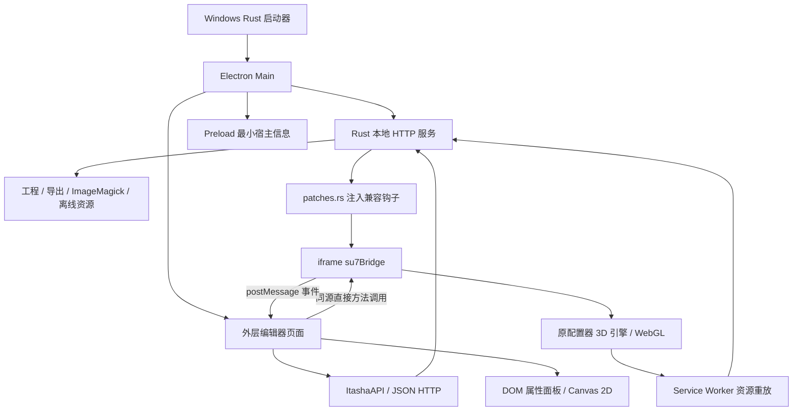

# 当前架构与前端性能重构报告

日期：2026-11-09（香港时间）
对象：高级软件工程师 / 前端重构负责人
审计主目录：`L:\SU7\痛车编辑器-下一版`
源码基点：`fa0733d`，2026-11-08 21:00:01 +0800，`fix: restore rear paint wrap coverage and migrate existing designs`

## 1. 结论与审计边界

当前系统是**离线配置器复用型桌面图形编辑器**：Electron 提供运行宿主，Rust 提供本地 HTTP、工程存储、图片处理和资源重放；编辑器外层为原生 JavaScript + DOM + Canvas，内层 iframe 运行捕获的官网配置器及其 3D 引擎，通过注入代码获得场景、材质和相机控制。

本轮最值得重构的是**交互事务、计算调度、像素传输和资源生命周期**。单纯更换 UI 框架，无法消除曲面计算、PNG 编码、纹理解码和同步序列化的成本。建议保留现有曲面算法及制作输出作为兼容基准，逐段替换执行与调度机制。

本报告依据当前源码、配置、已有性能 JSON 和本轮运行的轻量测试。没有重新启动图形基准、抓取 Chrome trace 或执行 GPU profiling，因此以下严格区分“代码事实”“历史实测”和“待验证假设”；不把静态审查当作已经定位到 CPU/GPU 热点的证明。

工作区同时存在 `SU7涂装工作室`（旧版与发布/运行资料）、`小米SU7选配页面_2026-11-07`（抓取资料）及下一版主开发目录。本报告重点分析下一版 0.2，不代表旧版安装包已具有相同架构。开始审查时下一版 Git 工作区无改动。

## 2. 系统边界与运行拓扑



注意：iframe 是文档与引擎集成边界，**不能据此认定曲面计算已经离开 UI 主线程**。当前代码没有通过 Worker 为这条计算链提供显式并行隔离；具体 frame/process/thread 分布应由实际 trace 确认。

| 层 | 当前职责与依赖 | 重构含义 |
| --- | --- | --- |
| 启动器 / Electron | 主进程启动 Rust、健康检查、窗口、会话 Cookie、关窗保存；preload 提供宿主信息 | 宿主边界已经较清晰，优先级低于渲染链路 |
| Rust 服务 | `tiny_http`、serde、存储、导出、图片服务、车型注册与离线归档重放 | 保留为 I/O 与原生处理边界；前端 CPU 计算不会自动受其线程设置加速 |
| 编辑器外层 | 工程、图层、历史、素材库、属性、2D 预览和同步协调 | 核心耦合集中在 `studio.js` |
| 3D 适配层 | 场景提取、拾取、覆盖网格、纹理、镜头、光照、输出 | `bridge.js` 同时承担适配和多项渲染业务 |
| 原配置器 | 车辆模型/材质/动画及内部渲染机制 | 上游资源改变会影响注入签名和私有接口 |

Electron 配置启用 `contextIsolation`、sandbox，禁用页面 Node；本地页面用 Cookie 访问后端。正常启动无调试端口。关窗契约位于 `desktop/src/lifecycle.cjs` 和 `app/desktop-host.js`。

## 3. 源码模块与装配方式

| 模块 | 规模（审计时磁盘字节） | 当前职责 |
| --- | ---: | --- |
| `app/studio.js` | 97,789 | 工程状态、UI、历史、导入、交互、同步、保存、制作导出 |
| `app/bridge.js` | 49,906 | 原引擎适配、网格/纹理、拾取、镜头与离屏输出 |
| `app/studio.css` | 45,722 | 工作区、面板、布局及交互视觉 |
| `app/surface-wrap.js` | 12,104 | 曲面图、邻接、覆盖与 UV 计算 |
| `app/wrap-rasterizer.js` | 7,401 | WebGL2 曲面预览批处理、纹理/几何缓存和降级 |
| `app/wrap-drawing.js` | 6,662 | Canvas 输出、曲面范围与选取等公共操作 |
| `app/paint-projection.js` | 5,882 | 普通图层五向投影与着色 |
| `app/camera-*.js` | 多文件 | 独立镜头数学、输入、构图和面板 |
| `app/core/api-client.js` | 965 | API 请求与保存快照的单次序列化 |
| `app/paint-surfaces.json` | 2,259,866 | 部件轮廓与漆面参考数据 |
| `app/surface-guides.json` | 2,255,717 | 参考数据文件；不能仅凭存在认定当前启动链使用它 |

文件大小反映职责集中度与资源量，不等价于运行耗时。源码大量逻辑写在很长的单行上，行数也不能作为复杂度度量。

前端没有独立的 npm 应用构建入口；`desktop/package.json` 管理 Electron、Playwright 和 pngjs。外层通过 `index.html` 顺序加载普通 script，模块用 IIFE 和 `window.SU7*` / `window.studio` 暴露能力。iframe 内 `bridge.js:4–10` 再串行加载投影、曲面、光照、镜头依赖。依赖顺序隐式存在于 HTML 和运行时脚本加载器中。

`backend/src/patches.rs` 对捕获的压缩 JS 做字符串替换，暴露 Three 风格的运行时类型与场景，并挂接 viewer/material。它不是一个拥有正式 SDK 契约的自研 3D 引擎。现有验收覆盖是替换适配层时的重要资产。

## 4. 状态与数据流

### 4.1 状态所有权

`studio.js:44–48` 闭包同时保存持久工程、选择/视图、ready/initializing、历史、图片缓存、拖动、同步定时器和保存队列。`window.studio` 的 getter 返回部分内部对象，其他模块可通过其取得项目与设置；这不是只读快照契约。

持久工程采用 `su7-livery` v1：`assets` 内嵌图片 data URL，`panels[region].layers` 保存图层，跨面层含 wrap 的 mesh/face/xy/uv 数据，并记录车型、配置、光照及尺寸。区域和车辆尺度仍有 SU7 固定值（`studio.js:8、187` 附近），多车型能力不能只靠扩充注册表获得。

`config/vehicles.json` 仅 Su7 标记 `baselineVerified: true`；其他六车型与通用模型导入不应算作已完成能力。

### 4.2 交互链路

**二维变换：** pointermove → 保存最新事件 → 每帧执行一次 `applyCanvasGesture()` → 必要时同步 `reframeWrap()` → 更新图层 → `previewWrap()` → Canvas 重画与属性更新 → 延迟同步 3D。已有 rAF 合并和一次手势一次历史提交基础。

**三维拖动：** iframe 拾取/事件 → postMessage → `moveArtwork()` → 同步 `makeWrap()` → 替换 wrap → `previewWrap()` → `changed()`。后者还执行素材库检查、拾取元数据更新、素材清理、Canvas 重画、图层列表重建、属性更新、3D 同步和自动保存调度（`studio.js:126、190–201`）。

**2D→3D：** `scheduleSync()` 合并触发 → `sync()` 遍历区域/部件并比较 JSON 签名 → Canvas 合成 → `toDataURL('image/png')` → 直接调用同源 bridge → `Image.decode()` → 创建或更新纹理 → 引擎请求帧。跨面 UV 有即时更新通道，普通图层/素材像素仍经过 PNG 字符串链路。

**保存：** `portableProject()` → `ItashaAPI.prepare()` 同步 stringify → Promise 队列发送 → Rust 持久化。当前已避免 stringify/parse 克隆后再次 stringify，但串行磁盘写队列不等于消除了主线程序列化。

**撤销：** 每次 `remember()` 序列化除 assets 外的整个工程，按 50 次及 12/24/48 MiB 预算裁剪（`studio.js:120–122`）。wrap 的大数组仍在每个快照中。文本长度×2只是估算，不是进程真实内存统计。

## 5. 已有优化：重构应保留的基础

- 普通二维输入已有 rAF 合并；相机变化和引擎重绘也按帧合并。
- `syncRunning/syncAgain` 限制并发同步，tile signatures 避免未变化的贴图重复生成。
- wrap 按不可变值更新；3D 用对象身份判断变化，拓扑不变时复用网格、上传 UV。
- 曲面交互预览已有 WebGL2 批处理；制作 Canvas/SVG 路径保持独立，避免将显示质量策略带进制作结果。
- GPU 预览缓存设有数量与字节预算；图片预览有缩放预算；仅编辑模式释放 3D，存在上下文失败回退。
- 独立镜头模块已有数学测试；真实模型验收覆盖 UV 连续性、部件投影、后部覆盖与工程迁移。

所以第一步应是完善可测量的边界与调度，而不是把已有全部算法推倒重写。

## 6. 历史性能证据与缺口

下表读取 `tools/acceptance/performance/verification.json`，时间为 **2026-11-08 20:57:03 香港时间**；不是本轮重新测量。配置为 Electron + release Rust、中画质、1600×1000、Core Ultra 7 265K、63 GiB 级 RAM、9,834 三角面跨面素材。

| 项目 | 记录值 | 解读 |
| --- | ---: | --- |
| 启动至首页 | 363.60 ms | 首页可用，不代表编辑器可操作 |
| 首次模型 | 3,720.31 ms | 新应用 profile，未清空系统磁盘缓存 |
| 4K 导入 | 3,598.83 ms | 包括测试图生成、编码、导入与预览，不能等同纯解码耗时 |
| 普通变换事件→下一 rAF P95 | 0.50 ms | 不含完整 3D 显示与呈现延迟 |
| 普通变换帧间隔 P95 / max | 8.50 / 66.70 ms | 已有尾部停顿 |
| 曲面重算 P95 | 17.20 ms | 单项已超过 60 Hz 的 16.67 ms 帧预算 |
| 曲面面板合成 P95 | 241.00 ms | `createPanel()` 制作/CPU 路径；不是 GPU 交互预览的单帧耗时 |
| 曲面变换事件→下一 rAF P95 | 37.30 ms | 存在明显优化空间 |
| 曲面变换帧间隔 P95 / max | 33.30 / 83.30 ms | 表明尾部卡顿，不能用空闲帧中位数代表交互流畅度 |
| 保存 | 516.79 ms | 测试工程约 6.05 MB（十进制） |
| Tab 工作集 / private | 1.62 / 1.44 GiB | 仅一个采样点，不能据此认定泄漏 |
| GPU 进程工作集 / private | 0.91 / 1.91 GiB | 进程内存，不等同显存占用 |

现有文档中约 0.63 秒首页、2.6 秒导入、30 ms 跨面 P95 是其他样本的摘要，和上述 JSON 不完全一致。建立新的基线时应统一报告文件、源码 commit、构建摘要与机器配置。

现有 `passed:true` 使用跨面 100 ms、重算 50 ms、模型 15 s 等回归门槛；这只能说明未超过当前门槛，不能说明达到 60 FPS。`curvePanelDrawMs`、内存与长任务没有纳入 passed 判断。

另有两点测量限制：

1. 名为 `curvedDrag` 的测试实际拖动外层 `[data-transform="e"]` 变换柄，主要覆盖跨面缩放，不能替代 3D 漆面位置拖动基准。
2. `getGPUInfo('basic')` 的设备记录全部 `active:false` 且部分实现字段为 none；WebGL rasterizer 的 available/draws 证明该路径被执行，但不足以证明使用了哪块硬件 GPU。下一轮应同时记录实际 WebGL renderer、feature status、GPU trace 和显示刷新率。

## 7. 性能风险清单与验证方式

| 优先级 | 已见代码事实 | 影响假设与验证 |
| --- | --- | --- |
| P0 | 3D 每次有效移动调用广义 `changed()`；列表以 replaceChildren 重建 | 热路径混入非交互工作；给 changed 子阶段打点并记录 DOM/layout/GC，再改为选择性失效 |
| P0 | makeWrap/reframeWrap 同步执行；历史重算 P95 17.2 ms | 曲面计算占用交互预算；分解搜索、覆盖、UV、分配时间，再决定 Worker 范围 |
| P0 | sync 中 PNG `toDataURL`，bridge 中重新 decode 并生成纹理 | 编码、Base64、解码及分配增加延迟；分别记录 encode/decode/upload/engine-frame，做 ImageBitmap 原型对照 |
| P1 | `selectionFrame()` 计算 wrap bounds；bounds 逐三角形裁剪 UV | 同次交互可能重复遍历大量几何；按 wrap 身份、区域和部件缓存，比较命中率与 CPU 时间 |
| P1 | 保存和历史均包含大规模同步 JSON；撤销全量快照包含 wrap | 自动保存或手势首次历史提交造成停顿；记录 stringify、快照字节与长任务 |
| P1 | 多处维护 images、sprite、WebGL、3D 纹理、atlas 和嵌入原图 | 局部预算不能代表总预算；做生命周期清单与重复切换/开关工程内存曲线 |
| P1 | `resources/custom.js:2–5` 全局强制 WebGL preserveDrawingBuffer | 可能增加缓冲成本；保持截图正确性的前提下做开关对照，不能凭此直接宣称已有瓶颈 |
| P2 | bridge 串行装载脚本；paint-surfaces 启动读取约 2.26 MB JSON | 拆分关键路径、预编译索引，检查模型准备各阶段耗时后再优化 |
| P2 | custom.js 与 bridge 用 MutationObserver 扫描 DOM；部分状态轮询 | 检查配置页 mutation 频率、扫描时长与编辑态是否仍触发，改为事件或局部观察 |
| P2 | splitter 连续写样式/持久化；ResizeObserver 直接 render | 面板拖动可能触发布局与合成抖动；录制 resize trace，按帧合并并在结束时保存设置 |

不要把 iframe 视为天然线程隔离，也不要把 `itashaPerformance.map()` 的 Promise 并发看作 JavaScript CPU 多线程。当前设置主要控制原生图片任务及异步任务并发。

## 8. 建议目标结构

```text
app/
  bootstrap/             装配、生命周期、功能开关
  domain/                Project、Layer、AssetRef、命令与版本迁移
  session/               选择、手势、视图、事务与 dirty 状态
  history/               命令/patch、检查点与内存预算
  geometry/              可独立执行的曲面与投影计算
  workers/               几何任务、版本号、取消与结果传输
  render2d/              显示列表、失效区域、预览合成
  render3d/              覆盖网格、纹理缓存、上传与帧请求
  adapters/captured/     私有引擎钩子、车型映射、拾取实现
  assets/                原图、预览、引用计数与统一预算
  persistence/           保存队列、序列化与 v1 兼容
  export/                制作输出与显示预览分离
  ui/                    面板、属性、素材库、交互绑定
  telemetry/             性能标记、资源计数与基准场景
```

这是一套建议边界，不要求一次性创建所有目录。可以先转 ESM + 类型检查，再逐个迁移；TypeScript 有助于约束数据与契约，运行时收益仍需来自算法、传输与调度改变。是否采用 React/Vue 等 UI 框架应由团队维护成本决定。

需要先确定四项契约：

1. **Document / Session / RenderCache 分离。** 持久工程只记录可保存数据；鼠标拖动中的临时结果与缓存有独立所有者。
2. **手势事务。** begin 捕获一次、update 仅更新预览、commit 写入文档和历史一次、cancel 恢复。自动保存只消费提交后的 revision。
3. **几何异步任务。** 将场景提取后的稳定几何快照转换为 TypedArray；任务携带 project/session/layer/revision，旧结果丢弃或取消。Worker 不接收 DOM、引擎 Mesh 或窗口对象。TypedArray 转移会让发送端失去 buffer，需预先定义所有权和双缓冲策略。
4. **RenderAdapter。** UI 不再直接操作引擎材质；适配器暴露 stage、camera、pick、geometry、artwork、frame、dispose 能力。兼容补丁留在适配边界，暂不连带替换原引擎。

像素链路建议先做同源 ImageBitmap/Canvas 直接消费的可行性实验；跨文档/Worker 通道采用 transferable ImageBitmap 时验证所有权、close 和失败回退。Blob URL 可作为过渡以避免 Base64，但仍可能发生编码解码。保留旧 PNG 路径作为 A/B 与回退，只有测得收益并通过像素回归后替换。

大工程的后续格式可采用 manifest + 二进制素材 + 几何数据的容器；保持 v1 可读，用新版本明确迁移。若继续保存派生 wrap 缓存，要记录模型/算法版本，不能在资源变化后盲目复用。

## 9. 实施顺序与每步退出条件

| 阶段 | 具体范围 | 退出条件 |
| --- | --- | --- |
| 0：冻结基线 | 给现有同步链打点，保存源码/构建摘要；补 3D 真拖动、多图层、大工程与降级场景 | 同一场景至少 5 次重复，可区分计算、编码、上传和呈现；保留原始 trace |
| 1：缩小交互热路径 | 将 3D 拖动从 changed 全量刷新迁出；按 layer/region/part 失效；合并布局与属性更新，缓存 bounds | 预览保持一致，一手势一次撤销，cancel/锁定/跨部件不回归；同步/DOM 次数明显下降 |
| 2：像素与资源 | 试点一条普通图层与一条 wrap 像素通路；统一资源登记、释放和预算 | PNG 编码次数及分配减少；纹理/位图无失效引用，循环开关工程内存无持续单向增长 |
| 3：异步几何 | 从纯数据计算开始 Worker 化；latest-wins、取消与双缓冲；主线程保留拾取和提交 | 不发生旧任务覆盖新工程；预览延迟下降；跨缝 UV 和覆盖验收保持通过 |
| 4：历史/工程 | 命令或 patch 历史、几何结构共享；保存格式兼容；制作导出异步化 | 大工程撤销/保存无明显长任务，旧工程重开及输出一致 |
| 5：完成模块迁移 | 收口全局对象、私有适配及车型数据；明确错误和销毁路径 | 新功能可在对应模块完成；宿主、真实车型和输出回归通过 |

前几个可独立审阅的变更建议：①只加 telemetry；②分离 gesture preview 与 commit；③缓存 wrap bounds 与图层索引；④替换一条像素链路并保留开关。每个变更均附同场景前后 trace，避免把多个变量一起替换。

## 10. 基准矩阵与建议门槛

下列为拟定目标，**不是当前能力承诺**；最终应由参考硬件、显示器与产品质量档位共同确定。

- 场景：空工程、50/200 普通层、1/10 个跨面层、接近 48,000 面单层；4K/8K 素材与多素材工程；新 profile / 热启动；重复打开、切仅编辑、恢复 3D、切画质、撤销/重做。
- 正确性：真实车辆跨缝 UV、后部覆盖、五向投影、相机/拾取一致、取消、部件姿态、保存重开、旧工程迁移和制作像素/尺寸。
- 流畅度：60 Hz 参考档，活跃拖动帧间隔 P95 ≤20 ms，33 ms 以上帧占比单列；主线程交互计算 P95 先压至 ≤8 ms，为浏览器布局/合成留余量。
- 延迟：分别记录输入→预览状态、输入→引擎消费、提交→完成同步；rAF 标记只能作为近似指标，不能命名为输入到像素延迟。
- 内存：分别测 JS heap、Tab/GPU private 与 working set、应用管理的 bitmap/texture/geometry 字节；检查 20 次生命周期循环后的平台值，不能简单相加当作物理内存。
- 输出：记录导出耗时、峰值内存、UI 可响应性与取消；241 ms 的 createPanel 应进入回归指标，避免只优化交互而忽略制作输出。

## 11. 本轮验证与交接索引

本轮执行：`node --test desktop/test/*.test.cjs tools/test/*.test.cjs`，**13 项通过、0 失败**，覆盖宿主配置、镜头数学和离线资源恢复工具。这不是端到端渲染或本轮性能验收。未运行 Rust、真实 Electron/模型及制作输出测试；本轮仅新增报告，没有修改应用代码。

建议阅读顺序与可直接定位的证据：

| 主题 | 源码位置 |
| --- | --- |
| 状态/历史/提交 | `app/studio.js:44、120、126–127` |
| 2D 画布与选区 | `app/studio.js:139–150`，`app/wrap-drawing.js` 的 bounds |
| 同步、签名、PNG | `app/studio.js:163–180` |
| 3D 拖动与曲面 | `app/studio.js:190–203` |
| 输入合并 | `app/studio.js:264–283` |
| 导出 | `app/studio.js:314–345` |
| 3D 纹理与网格复用 | `app/bridge.js:173–251` |
| 渲染预算与释放 | `app/bridge.js:373–419` |
| 适配注入与全局缓冲策略 | `backend/src/patches.rs`，`resources/custom.js:2–5` |
| 历史测量方法与数据 | `tools/benchmark-performance.cjs`，`tools/acceptance/performance/verification.json` |

建议启动重构时先认领阶段 0–1：建立可信基线并缩小交互提交面。随后用实测决定像素传输与 Worker 的实施顺序；在此之前保留现有曲面几何、原厂材质和制作输出作为回归基准。
