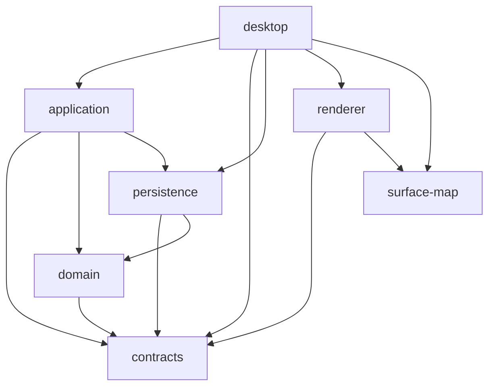

# NEXT 模块架构

本文描述 2026-11-17 整理后的实际源码结构。开发主线为 `next/`，版本 `0.3.0-dev.6`：React/TypeScript 负责界面与交互，Tauri 2 承接桌面命令，Rust 管理工程与存储，原生 wgpu 负责 3D。业务运行不依赖旧 Electron、Python 服务、旧 HTTP 后端或配置器 iframe。

Rust 应用服务中的工程文档是正式状态来源。React 保存只读投影、界面状态和交互预览；预览必须经过编辑命令才能进入文档及撤销历史，保存命令再将文档写入磁盘。根目录结构与资源范围见 [项目结构](项目结构.md)，构建与验收入口见 [开发与构建](开发与构建.md)。

## 源码位置与责任

下列路径均相对 `next/`。目录重排已完成，但不代表对应模块的所有后续拆分或功能已经完成。

| 路径 | 当前责任 |
| --- | --- |
| `src/main.tsx` | 创建 React 根节点 |
| `src/app/App.tsx`、`styles.css` | 组合功能界面、导航、未保存修改/关闭流程、设置；用 Promise 队列串行执行前端工程操作并刷新 View |
| `src/bridge/desktop.ts` | 手写 TypeScript 契约、`read_view`/`execute`/`close_clean`/目录选择封装与选配辅助数据 |
| `src/features/editor/` | 2D 画布、素材变换、整车排布、属性计算、选中状态、素材/遮罩读取及 2D/3D 预览同步 |
| `src/features/viewport/` | 原生视口占位、边界/DPI 同步、载入状态与视口操作 |
| `src/features/onboarding/`、`projects/`、`settings/` | 欢迎与车型选配、设计库、设置界面 |
| `src/features/workspace/` | 分栏工作区、检查器与停靠布局 |
| `src/shared/color/`、`input/`、`theme/` | 颜色控件/计算、快捷键、主题与公共样式 |
| `src-tauri/src/main.rs` | 模块声明、20 个现有 IPC 命令注册和运行入口 |
| `src-tauri/src/host.rs` | 应用服务与 blocking 调用、数据根、原生主题、启动和关闭事件 |
| `src-tauri/src/commands/{editor,assets,viewport}.rs` | 工程/设置、图片/目录、原生视口命令的校验和路由 |
| `src-tauri/src/adapters/su7.rs` | SU7 选配到本地模型包、材质、漆面地图的适配；原 `model_package.rs` 原样迁入 |
| `src-tauri/src/platform/viewport.rs` | Windows 子窗口、winit 线程、模型加载、GPU、手势与事件同步；原 `viewport.rs` 原样迁入 |
| `crates/` | 契约、领域、应用、存储、曲面算法、渲染六个 Rust crate |
| `catalog/vehicles.json` | 编译到 Rust 的车型与选配目录 |
| `assets/paint/` | 当前 v24 地图、v21 回归地图及历史布局尺寸证据 |

`bridge/desktop.ts` 目前只集中核心封装与类型。`App.tsx` 仍直接调用图片导入，`NativeViewport`、`useCanvasEditor` 仍直接调用视口 IPC 和监听事件，因此尚不能将它描述成统一收口的全部 IPC 层。TypeScript 与 Rust 契约仍需同步维护。

## Rust 依赖与边界

箭头表示直接依赖，仅列本项目 crate；`desktop` 是 `src-tauri` 的 `itasha-desktop`。



| crate | 当前责任与边界 |
| --- | --- |
| `contracts` | DTO、错误、会话/修订、设置、图层/锚点校验；无磁盘或 GPU 操作。仍包含 `SU7_SURFACES` 与 SU7 专属校验。 |
| `domain` | `ProjectDocument` v3、选配校验、Session、dirty、内容 ID、编辑及撤销/重做；无文件 IO。历史最多 100 条，并受 16 MiB 元数据预算限制。 |
| `persistence` | 具体 `Repository`、工作区锁、工程信封/摘要、替换写入、图片解码/规范化及 blob、设置、置顶与回收目录；损坏工程通过 `list_tolerant` 隔离并返回警告。 |
| `application` | Action 编排、会话/修订校验、View、工程/素材操作及成功请求去重；直接使用具体 `Repository`，未建立存储 trait，也不拥有线程。 |
| `surface-map` | 稳定三角形 ID、封口地图校验与指纹、UV/世界映射、物理尺度接缝传播、手势归属/序号/提交/取消；无工程存储和 GPU 依赖。 |
| `renderer` | `assets.rs` 加载包内 GLB/PBR/纹理并烘焙节点变换；`surface.rs` 准备漆面/遮挡/裁剪；`interaction.rs` 处理 BVH、拾取与变换；`gpu.rs`、`gpu/`、WGSL 负责绘制、相机、素材和抗锯齿。包含 CPU 文件读取与几何准备，不能视为纯 GPU 库。 |

`contracts` 与 `surface-map` 无其他本项目 crate 依赖。`desktop` 通过 `application` 调用领域，不直接依赖 `domain`。上述依赖无环，但并非已完成依赖反转的抽象存储架构。

## 线程与调用流程

当前有三类执行区域；应用层锁与渲染消息共同维持文档和预览的顺序。

| 执行区域 | 任务与顺序 |
| --- | --- |
| Tauri IPC / blocking worker | 工程/存储命令进入 `host::blocking`，通过 `spawn_blocking` 锁住 `Arc<Mutex<Application>>` 执行领域和存储操作。保存、图片规范化、列表与编辑仍受同一服务锁串行保护。 |
| `model-loader` 固定线程 | 接收模型 Plan，合并排队任务，并在加载前后检查 generation。已开始的解码不会中途终止；过期结果不会提交。 |
| `native-viewport` 固定线程 | 拥有 Windows 子窗口、winit 事件循环和 GPU；处理模型上传、原生指针、预览、绘制和状态发布。仅在可见且（dirty 或仍需时域收敛）时绘制，静止后等待。 |

SurfaceCache、状态、文档 stamp 与待上传像素通过共享状态和消息连接。部分 `prepare_layer`、`transport_layer`、coverage 几何计算仍在异步 IPC 调用路径同步执行，并未全部迁入专用 worker。

### 模型载入

`viewport_load` → blocking 读取 View/校验会话 → `adapters::su7::plan` → 可验证的旧地图指纹重绑定 → `NativeViewport::configure/load` → `Begin` 与 loader job → `renderer::assets::load` → `Loaded` → 原生线程准备 topology/masks、上传 GPU → `viewport-status`。

session epoch 标识工程会话，revision 标识已接受文档版本，generation 标识本次模型载入。它们共同阻止旧会话、旧文档或过期载入结果覆盖当前状态。

### 素材变换与保存

原生指针或 `viewport_gesture` → GestureService 临时预览 → GPU 临时状态与 `viewport-preview` → commit 产生 `viewport-edit` → 前端发送 `execute(Action::Edit)` → Session 更新文档/历史 → `document_changed` / `Message::Editor` 同步 GPU。

渲染线程不会直接保存预览；明确的 Save Action 才调用 Repository 写盘。取消手势恢复临时状态，不产生撤销记录。2D 栅格预览通过 `viewport_decal` 发送 RGBA、尺寸和版本 headers，原生线程核对 stamp 后上传；`viewport_surface` 与 `asset_bytes` 分别返回遮罩和图片二进制数据。这些像素不属于工程 JSON 的文件格式。

关闭按钮先发出 `close-requested`，由界面处理未保存修改，再调用 `close_clean`；服务确认 clean 后销毁窗口。

## 工程、资源与地图

默认数据根为 Tauri `app.path().app_data_dir()`，应用标识为 `studio.itasha.editor.next`。`ITASHA_TEST_DATA_DIR` 可在 debug/release 覆盖数据根，用于隔离验收。

```text
数据根/
├─ .workspace.lock
├─ projects/<uuid>.json              # storageVersion=1 信封，文档版本 3
├─ settings.json
├─ library.json                     # pinnedProjectIds
├─ blobs/<sha256>.png                # 规范化、去重的图片
└─ trash/projects/<id>-<uuid>.json
```

保存先校验文档、引用图片及摘要，再在同目录写入临时文件、sync 并替换目标；工程元数据上限为 8 MiB。这里保证正常运行中的完整文件替换，不承诺断电耐久性。图片支持 PNG/JPEG/WebP，输入最多 20 MiB、边长最多 8192、像素最多 16777216，解码后规范化为 PNG 并按 SHA-256 寻址。`asset_bytes` 仅允许读取当前工程引用的图片。

`config/vehicles.json` 与 `vehicles/*/backend-adapter.json` 经目录工具生成 `next/catalog/vehicles.json`，由 domain 的 `include_str!` 编入程序。普通运行不依赖生成工具或旧后端。目录可展示其他车型条目，完整模型/编辑通路目前只接入 SU7 Max；当前选配轴为车漆、轮组、内饰、方向盘。黑化套装、碳纤维后视镜/迎宾踏板等独立选配仍需按车型补齐，不能从目录条目推断已经实现。

模型使用独立本地基线 `L:/SU7/3D/Blender/software`。配置的 `paths.models` 及其 `Blender/software`、`software` 子目录参与查找；未配置时从 exe 祖先查找 `3D/Blender/software` 或 `models/su7`。地图依次查模型包 `paint/paint-map.json`、exe 祖先的 `assets/paint/su7-v24-mirrored/paint-map.json`、编译工作区相对回退路径。SU7 参数与材质近似不直接适用于其他车型，具体包约定见 [接口与车型适配](接口与车型适配.md)。

地图必须通过封口/指纹校验，`modelFingerprint` 匹配 `body.glb` 的 SHA-256，源三角形和重心映射也需验证。v24 是当前运行地图，v21 用于兼容回归，v15 只保留布局尺寸报告。原始模型和 Blender 工程不随源码仓库分发，资源恢复见 [离线资源](离线资源.md)。

`paths.exports`、`paths.cache` 当前只参与目录校验、写权限探测和设置保存；施工导出与磁盘缓存尚未实现。`cache_budget_mb` 尚未控制 Rust 渲染预算；`reduced_motion` 作用于前端样式，未控制原生渲染。纹理设置虽然允许 8192，SU7 adapter 仍将实际模型纹理上限截为 4096。

## 工具分组

所有工具路径相对 `next/`，脚本入口已随目录重排更新。

| 路径 | 用途 |
| --- | --- |
| `tools/checks/` | `pnpm check:boundary` 静态检查旧运行依赖、iframe/网络入口等边界；不是运行行为证明 |
| `tools/tests/` | 变换、属性、整车排布等前端计算回归 |
| `tools/smoke/` | 桌面、漆面与编辑验收；使用 NEXT 自身的 Playwright/pngjs 和隔离数据目录 |
| `tools/catalog/` | 根据仓库车型配置生成 catalog |
| `tools/assets/` | 模型/漆面/UV/PSD 审计与生成；依赖另行恢复的原始资源或历史输入 |
| `tools/legacy/` | 旧版盘点和归档，不属于 NEXT 构建或运行链路 |

桌面 smoke 可用 `ITASHA_MODEL_ROOT` 指定模型根（默认 NEXT 外的 `../../3D`），用 `ITASHA_SMOKE_EXE` 指定可执行文件。工具要求、输入和入口详见 [工具说明](../next/tools/README.md)。

## 后续修改位置与当前限制

| 修改内容 | 主要入口与同步核对 |
| --- | --- |
| 界面、布局、颜色、快捷键 | 对应 `src/features/` 或 `shared/`；组合与导航在 `app/App.tsx` |
| IPC 或契约 | `commands/`、`main.rs`、`build.rs`/权限、Rust contracts 与前端 bridge/直接调用方 |
| 工程动作、会话与撤销 | application、domain；涉及文件格式时同时核对 persistence 与兼容测试 |
| 图片、保存、库与回收 | persistence；同时核对 assets 命令与输入预算 |
| 新车型/独立选配 | adapter、catalog、contracts 的部件约束；不能只增加目录条目 |
| UV、接缝与手势 | surface-map；同时检查 renderer interaction、宿主手势与真实地图回归 |
| GLB、材质、GPU 与抗锯齿 | renderer assets/surface/interaction/gpu；配合真实 GPU smoke |
| Windows 嵌入、DPI、遮盖与绘制调度 | `platform/viewport.rs` 与前端 NativeViewport |

当前原生宿主依赖 Win32，尚无跨平台完成保证。`platform/viewport.rs` 仍集中管理窗口、线程、手势、GPU 与缓存；宿主 SurfaceCache 和 renderer Geometry 也仍分别保存 topology。Application 尚无后台快照保存/自动保存调度；通用 GLB 导入、旧 `.su7design` 迁移、完整其他车型、施工导出、安装包与完整发布验收仍未完成。

已知真实地图回归仍需修复：`every_reviewed_body_seam_transports_local_artwork_in_both_directions` 中，v24 的 300×300 mm、旋转 0.17 素材从 `su7.front-left-lower-fender` 错误传播到右后门/右后翼子板。结构重排没有修复该算法，也没有移除断言；整理前后证据见 [NEXT 主线切换记录](NEXT主线切换-2026-11-17.md) 与 [结构整理验收](结构整理-2026-11-17.md)。

`docs/重构设计/` 保留有日期的设计与实施证据。历史 Gate、性能目标或旧版并行约定不代表当前实现；后续开发入口以根 README、AGENTS 和上述实际模块边界为准。
