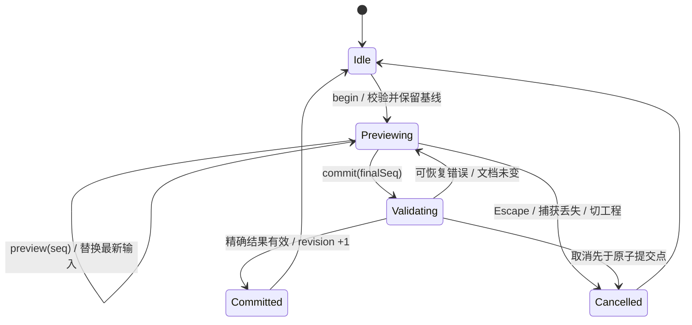

# 阶段 3：编辑会话、曲面贴花与历史事务

导航：[总览](./README.md) · [前置阶段](./阶段2-通用模型管线与3D渲染器.md) · [公共契约](./附录A-跨阶段数据与并发契约.md) · [验收口径](./附录B-性能验收与需求追踪.md)

状态：Draft 0.1；设计目标尚未实测。
估计：4–6 周。
依赖：阶段 2 的语义 Surface、HitRecord、renderer API 和 model fingerprint。
目标：车型无关的图层编辑流程，以及 SU7 跨部件涂装兼容。

## 1. 交互事务

持久文档变更与每帧交互预览分开。拖动过程中不重建完整工程 JSON；一次手势对应一个历史记录。事务协调器属于 Rust application，原生视口通过进程内队列调用，React 属性面板/2D 视图通过 Tauri adapter 调用同一用例。



Rust 原子应用命令前可取消；提交点之后到达的 cancel 返回 `already-committed`，UI 可执行 undo。相同 requestId 的 commit 重试返回原结果，不再次产生 history entry。进入 Validating 后暂停该 layer 的其他编辑，允许相机操作和保存此前已提交文档。

## 2. 持久数据与临时数据

| 数据 | 所有者 | 关键内容 |
| --- | --- | --- |
| ProjectDocument | Rust document actor | projectId、contentId、vehicleRef、modelFingerprint、assets、layers、surfaceProfiles |
| Layer | ProjectDocument | layerId、kind、visible、locked、opacity、orderKey、source、placement |
| Placement | Layer | `planar` 或 `surface` tagged union；各自的单位/坐标系、尺寸、旋转、锚点 |
| SurfaceAnchor | surface placement | canonical mesh/primitive key、triangle、barycentric、切线框架、model fingerprint |
| Gesture | Rust session actor | gestureId、baseRevision、起始 layer、sequence、最后有效 preview、状态 |
| WrapGeometry | geometry cache | coverage version、model/surface fingerprint、primitive patches、UV 与 topology signature |
| RenderCache | renderer | 与 layer/geometry revision 对应的 buffer、texture、selection overlay |

`ProjectDocument` 的语义字段是工程来源；wrap 派生几何可带 hash/version 缓存以加速重开，但不是唯一可恢复来源。没有模型时保留旧缓存和锚点，禁止猜测不同 topology 的 triangle index。

planar placement 用 `SurfaceProfile` 定义的局部二维米制坐标；旧工程像素坐标由迁移器按旧区域宽高换算。surface placement 用参考姿态 mesh 局部空间的稳定 barycentric anchor 与 tangent frame。部件开启后的世界坐标只用于显示/拾取，commit 时反变换回参考姿态。

## 3. Gesture 流程

### 3.1 Begin

收到已验证 HitRecord 或属性输入操作后，检查 layer 可见/未锁定、model fingerprint、项目 epoch、revision 和目标权限。记录单层 before value 与相关 asset/geometry 引用，创建 token；不 clone 整工程、不创建 history entry、不标 dirty。选中 layer 与普通相机移动无需 document revision。

### 3.2 Preview

- native viewport 合并最新 pointer 输入，每个显示周期最多处理一次；相机运动和 hover 不经过 React state 更新。
- React 中 2D Canvas 的 pointer 输入可每帧合并后发送一个无几何数组的 placement preview；存在一个 in-flight 请求和一个 latest pending slot，禁止等待每个 pointermove 的 round trip。UI 可立即绘制临时手柄，精确结果到达再校准。
- 几何任务携带 `sessionEpoch + gestureId + seq + modelFingerprint + baseRevision`。只接受当前 gesture 的最新 sequence；取消 token 用于减少无效工作，版本校验才保证正确性。
- 只更新操作 layer 的 UV/mesh ranges、outline 和需要显示的属性数值。图层次序和素材列表在本次预览未变化时不刷新。
- 文本/数字输入本地保留未完成字符串；合法值才形成 preview，blur/Enter 提交，Escape 撤销整个输入事务。
- 部件或画布切换导致 layer 消失、锁定、失去 pointer capture、模型切换、app 关闭时取消；不让旧任务恢复 overlay。

在 native 路线上，同一 Rust geometry crate 可由视口和 2D 控制入口共用。若 Gate 0 改选 WebGPU，必须重新测量 Rust↔WebView 的几何输出量与延迟；不能默认把大型 UV buffer 每帧通过 channel 发送也能达到原生预算。可试点同 crate 的 WASM 预览，但要作为另一项明确决策，持久提交仍在 Rust Core。

### 3.3 Commit

提交包含 `finalSeq` 与最终 placement。若对应精确几何尚未完成，保持 Validating；不能把较老 preview 提交。精确结果通过 face/byte/finite/bounds 校验后，document actor 再检查 baseRevision 和 epoch，以一次原子操作更新 Layer、生成 inverse patch、revision +1、contentId 变化并写入 history。

结果通知包括 `changedLayerIds`、`changedSurfaceIds`、geometry handle、revision、contentId。renderer 将 transient overlay 切换为 committed state；React 更新受影响组件；从此刻启动 autosave debounce。若 revision 冲突，初稿采用显式拒绝与重取状态，不做无提示 rebase。

### 3.4 Cancel 与错误

cancel 不产生 revision/history/dirty 变化。释放 transient geometry，恢复 layer before render state。若 worker 失败而此前存在有效 preview，保留该 preview供用户调整；commit 必须重新通过精确验证。若 renderer 崩溃，Rust 文档仍可保存；正在进行的未提交 gesture 取消。已提交后 GPU upload 失败时，文档保持新 revision，UI 显示渲染故障并重建，而不是隐式撤销。

## 4. geometry 任务契约

以下为接口设计，最终 Rust/TS 名称由阶段 1 contract registry 统一：

```text
WrapRequest {
  taskId, sessionEpoch, baseRevision, gestureId, seq,
  modelFingerprint, adapterVersion,
  hit: StableSurfaceHit, placement: PlacementSpec,
  profile: preview | exact,
  limits: { maxFaces, maxDistanceMeters, maxResultBytes }
}
WrapResult {
  taskId, sessionEpoch, gestureId, seq, modelFingerprint,
  coverageVersion, topologySignature, geometryHandle, metrics
}
```

Native 内部数据用 `Arc` 引用不可变几何和受控 buffer pool，TS DTO 只包含 handle/摘要。导出和跨边界传输才产生明确的二进制布局：float32/float64、index32、字节序、长度、单位、版本。计算中对边界误差使用足够精度；GPU 最后一步转换，不在每次 pointermove 反复 JSON roundtrip/四舍五入。

任务池初始并行度为保留 UI/renderer 余量后的 CPU 配额，数值由实测配置。每个 gesture 最多一个 running 和一个 replaceable pending job；跨项目全局有总内存预算。超过 maxFaces 或字节预算返回错误，禁止静默裁断却标记 exact 成功。

算法迁移保留旧版已有覆盖行为，但把旧 `doorL/doorR/bonnet/trunk` 条件转换为 adapter 的朝向/外壳约束。车长、五向投影 bounds、接缝距离由 SurfaceProfile 给出；单层 48,000 面作为初始兼容预算，未来更改必须同步迁移/校验/验收。拓扑不变时只更新 UV，拓扑变化才重建覆盖网格。

## 5. 2D 与 3D 同步

设计 Canvas 采用可命令式调用的 `CanvasController`，React 管理其挂载与面板。静态图层合成缓存在 backing surface，活动层在独立 overlay 中变换；如果混合模式/顺序导致无法独立叠加，重绘受影响范围或受限整区域，正确性优先于缓存命中率。

失效类型固定为 selection、layer-placement、layer-pixels、layer-order、surface-composite、model-topology。透明度/顺序改变会影响叠加；不能仅凭 texture hash 认定整个 surface 有效。纹理上传由 AssetRef + content hash 缓存，placement 修改不重新 PNG 编码。选区 bounds 用 layer/coverage revision 缓存，避免多次逐三角形裁剪。

图层面板订阅单层/顺序 read model；素材库订阅 assets revision；属性面板订阅 selection 与当前字段。每帧 preview 不广播整个工程。初版选择 UI store 的具体库在阶段 1 决议，后续模块不得各自再引入竞争的全局 store。

## 6. History、dirty 与保存

命令具有 before/after values 和必要 blob 引用。恢复/重做以新 revision 执行，revision 不回退；`contentId` 随文档逻辑内容恢复，因此 undo 回到刚保存内容可显示 clean。资产不能在 undo 引用仍存在时删除；history checkpoint 与缓存各自计费。

命令合并只发生在同一 layer、同一字段、明确输入事务内。history 同时限制条数与估算字节；最近项超预算时先产生 checkpoint、报告可撤销范围变化，不能悄悄失去当前操作。来源素材通过 blob repository 共享；不将原图或全量 wrap JSON 复制进每一步。

保存仅捕获 Rust 中已提交的 immutable snapshot。保存完成的 `savedContentId` 和 `savedRevision` 与当前状态分别比较；进行中的手势不进入该快照。完整写入/恢复由阶段 4 定义。

## 7. 必测用例与证据

| ID | 场景 | 退出标准 |
| --- | --- | --- |
| E3-01 | 普通 2D 拖动/缩放/旋转 | 一 gesture 一 undo；与属性输入一致 |
| E3-02 | 3D 漆面实际位置拖动 | 锚点与拾取一致，跨门/曲面结果合法；另测 2D transform handle |
| E3-03 | 锁定、Escape、捕获丢失、切车 | cancel 后 document/history 不变，无迟到 overlay |
| E3-04 | 乱序/重复 commit 与 worker 迟到 | 幂等、epoch/revision/seq 校验，无旧结果覆盖 |
| E3-05 | 曲面接缝与非 SU7 fixture | 共享缝点 UV 偏差目标 ≤1e-5；拓扑容差定义在车型 fixture |
| E3-06 | 开合部件/回到配置再编辑 | reference pose 的 anchor 不漂移，编辑态部件权限正确 |
| E3-07 | 100/200 图层、10 曲面层 | 帧/任务队列有界；资源稳定；长任务有记录 |
| E3-08 | undo/redo、保存并重开 | Layer/AssetRef/锚点/排序/材质保持语义等价 |

默认跨面层允许从 3D 与受约束的 2D 投影视图定位，需命中有效漆面后调用同一 SurfacePlacement 用例。若要恢复更早的“2D 只能选中”规则，作为明确 UX 变更记录，不由实现者自行推断；当前代码可进行投影拾取的行为作为迁移基线。

## 8. 性能目标与交付

参考机几何计算 P95 目标 2–8 ms、交互处理到 GPU submit 目标 10–20 ms，低配 18–33 ms。这些值不是输入到显示器像素的保证；显示帧间隔另按附录的统一口径测量。单次 commit 精确计算预算初设 100–500 ms，超时继续响应并允许取消，不能自动降低制作精度。

交付 editing schema、gesture 状态机、geometry API、可复跑 golden fixtures、命令历史、renderer 更新契约、2D/3D 真实手势报告及性能 trace；阶段 4 以这些不变量验收保存与输出。
