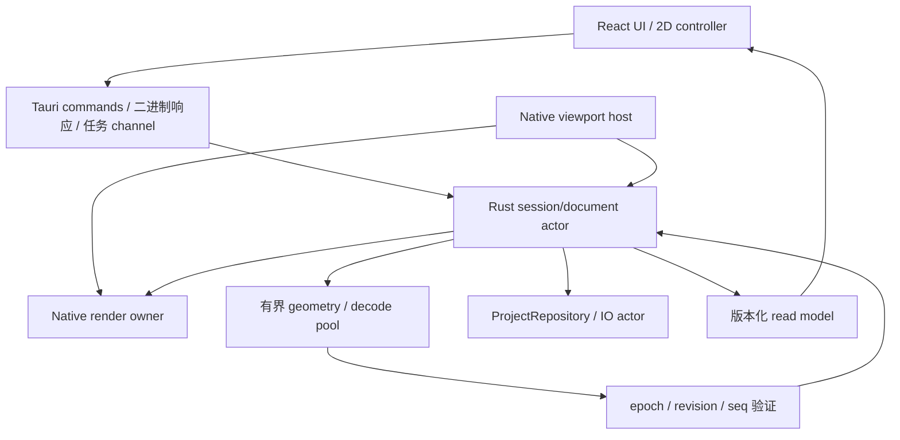

# 附录 A：跨阶段数据与并发契约

导航：[总览](./README.md) · [性能验收与需求追踪](./附录B-性能验收与需求追踪.md)

状态：Draft 0.1。本文是阶段文档的接口一致性依据；所有命令和数据结构为拟定契约，尚未实现。

## 1. 全局不变量

| 编号 | 不变量 |
| --- | --- |
| I-01 | ProjectDocument 只有 Rust document actor 可提交变更；UI/renderer 不能直接写工程文件 |
| I-02 | 一次用户编辑 commit 至多产生一个 document revision 和一个历史条目 |
| I-03 | preview 不改变持久文档、dirty 或 autosave；取消只清理临时资源 |
| I-04 | 保存 snapshot 固定于受理时的 committed revision，进行中的编辑不能混入本次保存 |
| I-05 | generation、model fingerprint 或 sessionEpoch 不匹配的结果不能更新当前视图/文档 |
| I-06 | 旧 primitive/triangle 引用必须经过版本匹配或 remap，不能凭 mesh 名称猜测 |
| I-07 | GPU handles/DOM 对象不入工程；可重建缓存与用户源资产分别管理 |
| I-08 | 发行应用不依赖业务 HTTP、Service Worker、iframe 和小米引擎脚本 |
| I-09 | UI 类型检查不代替 Rust runtime validation；错误返回稳定 code |
| I-10 | 所有发布功能有车型/格式/设备矩阵，缺项不能由“能显示模型”替代 |

## 2. 线程与组件所有权



这是 Native 首选路线。Tauri 主事件线程只执行平台窗口要求的操作；domain actor 顺序处理文档命令，IO/解码/geometry 在后台工作。不能把 blocking decode 放在 async command 内却继续阻塞 executor；实际实现采用有界 blocking pool 或独立 worker。

CPU immutable mesh 由 asset repository 持有，geometry 和 renderer 共享读取。renderer 独占 GPU 对象生命周期；document snapshot 用不可变共享结构，存储期间不长期持有全局写锁。任务返回后由 actor 校验与提交，worker 不自行改 project。

## 3. ID、版本与信封

| 字段 | 格式/范围 | 作用 |
| --- | --- | --- |
| requestId | UUID | 每条有副作用命令的幂等键 |
| projectId | UUID | 持久项目身份 |
| sessionEpoch | UUID，每次打开/新建生成 | 隔离相同 projectId 的不同会话 |
| revision | Rust u64；JSON 十进制字符串 | 单会话提交序号，避免 JS number 精度损失 |
| contentId | 内容节点 ID | 标识逻辑内容，undo 可回到已保存 contentId |
| modelFingerprint | sha256 + 规范化格式版本 | 绑定 canonical geometry/material profile |
| taskId / gestureId | UUID | 任务/事务身份 |
| seq / eventSeq | 有界整数，溢出前换 session/gesture | 合并预览和检测缺失通知 |
| RenderHandle | generation + runtime ID | 仅运行时有效，不序列化到持久工程 |

每个 typed mutation 参数包含 `{requestId, sessionEpoch, expectedRevision, payload}`，不是任意 operation 字符串的万能 execute。读取 app/settings 等非项目命令可不带 sessionEpoch。task-progress 事件包含 projectId/sessionEpoch/taskId/eventSeq。

Rust DTO 使用明确 tagged union 与长度/数值上限，生成 TS 类型并输出 checked-in contract schema；CI 生成后检查无差异。runtime 仍执行语义校验：有此 layer、该 asset 属于项目、surface fingerprint 匹配、值在有效范围。UI 收到未知 contract major version 时停止编辑并提示升级，不忽略必需字段。

## 4. Command catalog

| 命令组 | 请求要点 | 成功语义 | 阶段 |
| --- | --- | --- | --- |
| app_get_info | 无 | capabilities、版本、功能档位摘要 | 1 |
| project_create | name、vehicleRef 可空 | 创建新 session 与空文档；是否保存独立执行 | 1 |
| project_open | ProjectRef 或 FileGrant | 完整验证后原子替换当前 session；dirty 当前工程先处理关闭事务 | 1/4 |
| project_get_snapshot | SessionRef | 文档/UI 摘要与当前 revision/eventSeq，不含大图字节 | 1 |
| project_list | cursor、pageSize 上限 | 项目摘要分页 | 1 |
| project_save | expectedRevision、requestId | Rust 捕获 committed snapshot；返回 TaskRef，结束时返回 savedRevision/contentId | 1/4 |
| project_export | SessionRef、目标 FileGrant、格式参数 | 导出受理时 revision 的便携文件/图片 | 4 |
| vehicle_list / vehicle_configure | vehicle/option IDs | 返回可用能力；配置准备完后原子切换 | 2 |
| asset_import_begin | picker/drop FileGrant、导入用途 | taskId；逐项结果，成功素材经命令入工程 | 2/4 |
| asset_read_preview | AssetRef、previewProfile | 受限长度二进制；UI 建 Blob URL | 2 |
| edit_begin / edit_preview | layer、placement、seq | 创建/推进临时 gesture；不产生 document commit | 3 |
| edit_commit / edit_cancel | gestureId、finalSeq | 原子提交或取消；重试不重复写 history | 3 |
| layer_add/remove/update/reorder | 单一明确语义的 payload | 校验后产生 revision 与 inverse patch | 3 |
| history_undo / history_redo | expectedRevision | 新 revision，恢复对应 contentId | 3 |
| task_get / task_cancel | taskId、归属 session | 返回状态或确认取消请求，不冒充已经撤销完成 | 1+ |
| settings_read/write | settingsVersion、偏好 | 配置保存；影响 Native/WebView 的重启条件分别返回 | 1 |

ProjectRef 是应用管理 ID，FileGrant 是用户 picker/drop 授予的有限范围引用。两者不得合成“任意路径读写”命令。导出可以选择 app-owned 目录以外的路径，后端仍校验 grant 的用途和有效期。

## 5. 幂等、冲突、重同步

有副作用命令先查 `(sessionEpoch, requestId)` 的近期受理记录；重复请求返回同一 TaskRef/已提交结果。不同 payload 复用同 requestId 返回 `invalid-input`。保留窗口有界，超过窗口的未知重试不可盲目重放，先查询 revision/task 状态；持久保存另以 manifest revision/hash 保证崩溃恢复后识别结果。

初稿采用单文档串行提交。expectedRevision 不等于当前 revision 返回 `revision-conflict`；UI 拉取 snapshot 后重新表达操作，不自动覆盖其他输入。begin 期间另一个命令删除/锁定 layer 会令 gesture 失效。配置切车使 scene generation 变化，必须取消所有绑定旧模型的 gesture。

事件不是完整数据库复制协议。UI 先订阅再取 snapshot，用 eventSeq/revision 丢弃旧事件；发现 gap、WebView reload 或 reconnect 时重新读取 snapshot。任务必须可用 task_get 查询，不能仅依赖唯一一次 finished event。progress 低频合并，终态保存一段保留期；发往所属窗口，不全局广播大 payload。

## 6. 任务状态与取消

```text
queued -> running -> succeeded | failed | cancelled
running -> cancelling -> cancelled | succeeded
```

受理 task_cancel 仅表示取消被请求。文件原子提交点之后不能删除有效输出来假装取消；最终可能返回 succeeded，并解释已完成。不可取消的短原子区设置 cancellable=false。queued 任务可移除，running worker 定期查 token，generation 校验兜底拒绝迟到结果。

所有任务有 owner、资源预算、deadline（仅适用支持超时的任务）、进度阶段与 staging 清理规则。任务超时与用户取消有不同错误码。app 退出按阶段 4 的关闭状态机等待保存，后台无主任务不能继续占用用户工程。

## 7. 二进制与资源生命周期

| 场景 | 设计通路 | 所有权/回收 |
| --- | --- | --- |
| Native 模型与纹理 | Rust 文件 reader → shared CPU data → GPU upload | repository/ref-count/renderer drop |
| React 缩略图 | 小尺寸 raw response → Blob URL | 组件/列表卸载 revoke；cache 有字节上限 |
| progress/status | channel 小 DTO | 合并中间事件，终态可查询 |
| 大便携文件/导出 | Rust 直接写 FileGrant | 不传整文件到 WebView |
| WebGPU 备选几何 | 需独立二进制协议原型 | 精确测复制次数/字节量，不能假定零拷贝 |

Tauri raw response 可避免普通 JSON 数字数组开销，但不等于操作系统共享内存或零拷贝。channel 也不是自动的显存纹理共享机制。首期只用明确的句柄/响应；共享内存、D3D texture interop 留作独立 ADR，不能成为未实测的基础依赖。

边界上限由 `ResourcePolicy` 集中配置并带版本：源文件字节、解码像素、单模型 triangles、输出像素、wrap faces/result bytes、并发任务、CPU/GPU cache。预算不足时优先降低可重建预览，保留用户源数据并给出明确错误。具体数字在 G0 资产统计后冻结；旧 48,000 面/层作为迁移 fixture 的兼容基线。

## 8. 错误与权限

统一错误结构为 `code + messageKey + retryable + taskId? + details`；details 只包含可展示的数据，例如当前/期待 revision、缺失 SurfaceId、资源上限。日志关联 requestId/taskId，原始路径按诊断策略脱敏。

核心错误：invalid-input、unsupported-format、asset-not-found、asset-too-large、model-mismatch、project-corrupt、schema-unsupported、revision-conflict、cancelled、timeout、already-committed、renderer-unavailable、permission-denied、io-error、internal-error。

主窗口自定义命令显式加入 AppManifest command 权限配置；只写 plugin capability 不能证明项目 commands 受限。多窗口叠加 capabilities 的有效权限需检查。FileGrant 绑定会话/窗口/用途，用户选择某文件不等于前端获得整个父目录。程序自身持有文件路径可用于可靠 I/O，但不能把路径当作不经验证的外部权能。

## 9. 必须先行冻结的 ADR

| ID | 待决问题 | 初稿方向 | 最晚阶段 |
| --- | --- | --- | --- |
| ADR-001 | Native view 与 WebGPU 承载 | Native 优先；以同窗输入/叠层/DPI 证据决定 | G0 |
| ADR-002 | SU7 canonical geometry 与三角 remap | 保留精确编辑几何，显示 LOD 独立 | G0/G2 |
| ADR-003 | 车漆、玻璃等材质 profile | 自有 shader 对应原参数；缺项列诊断 | G2 |
| ADR-004 | React UI store、DTO 生成工具 | 单一 store、Rust contract 生成 TS | G1 |
| ADR-005 | 工作目录保存与外部文件绑定 | 增量工作副本 + 显式便携导出 | G1，G4 完整验收 |
| ADR-006 | 文本/字体/ICC 输出 | 屏幕/制作 profile 分离，旧能力逐项对照 | G2–G4 |

决策记录必须包含问题、候选、选项、证据、兼容影响及退出条件；这张表不是宣称这些决策已经批准。

## 10. 技术依据

核对日期：2026-11-09。下列为官方文档地址；实施时锁定 Cargo/pnpm 与系统运行时版本，不将网页内容视为锁定依赖。

| 资料 | 设计中采用的事实 | 官方地址 |
| --- | --- | --- |
| Tauri Process Model | Rust Core 与 WebView UI 有独立职责，Windows 使用 WebView2 | `https://v2.tauri.app/concept/process-model/` |
| Tauri Calling Rust | 普通 Serialize 返回值走 JSON；二进制可用 ipc::Response | `https://v2.tauri.app/develop/calling-rust/` |
| Tauri Capabilities | 自定义 invoke_handler 命令需额外配置 AppManifest::commands 才纳入命令权限控制；多个 capabilities 可能合并权限 | `https://v2.tauri.app/security/capabilities/` |

这些事实只决定接口边界；原生 viewport 与 WebView 的整合性能仍由 G0 原型验证。
