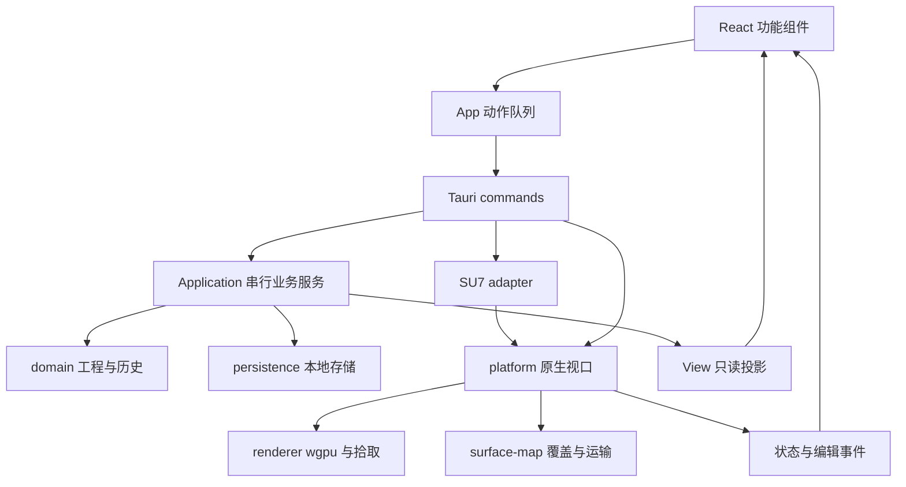

# 项目整体结构

本说明对应 2026-11-17 实际整理后的源码。唯一应用工作区为 `next/`，后续功能、修复和测试均在这里开发。目录已按职责重排并修正引用；本轮没有重写跨面算法、升级依赖或改动车辆原始资源。

## 仓库总览

```text
仓库根目录/
├─ README.md、AGENTS.md           项目入口与开发约定
├─ 启动工作室.cmd                启动 NEXT 发行 exe
├─ next/                         唯一应用工作区
│  ├─ src/                       React 界面与前端调用
│  ├─ src-tauri/                 Tauri 桌面宿主与命令权限
│  ├─ crates/                    Rust 业务与算法模块
│  ├─ catalog/vehicles.json      编入 Rust 的车型选配目录
│  ├─ assets/paint/              当前映射与必要回归数据
│  ├─ tools/                     检查、测试、资源和历史工具
│  ├─ Cargo.toml、Cargo.lock     Rust workspace 与锁定依赖
│  └─ package.json、pnpm-lock.yaml  前端命令与锁定依赖
├─ config/vehicles.json          车型目录来源
├─ vehicles/*/backend-adapter.json  车型选配来源，供目录生成
├─ tools/git-auto-sync.ps1       本机仓库同步辅助脚本
└─ docs/                        当前说明、验收与历史设计
```

根目录本机保留的旧 `app/`、`backend/`、`desktop/`、`projects/` 等已退出当前 Git 树。历史恢复方式见 [仓库管理](仓库管理.md)。

## 前端：入口、功能与共用模块

```text
next/src/
├─ main.tsx                     createRoot 挂载入口
├─ app/
│  ├─ App.tsx                   页面装配、动作队列、导航和关闭保护
│  └─ styles.css                应用全局布局样式
├─ bridge/
│  └─ desktop.ts                TS 契约与基础 Tauri 调用封装
├─ features/
│  ├─ onboarding/               欢迎、新建、车型与基础选配
│  ├─ projects/                 工程库容器、宽度与折叠
│  ├─ settings/                 设置面板
│  ├─ workspace/                分屏与右侧面板布局
│  ├─ editor/                   2D 画布、素材、图层与编辑协调
│  └─ viewport/                 原生 3D 容器、尺寸与状态
└─ shared/
   ├─ color/                    颜色组件、颜色计算与样式
   ├─ input/                    共用快捷键解析和显示
   └─ theme/                    主题 hook 与变量
```

`app` 装配功能模块；`features` 可使用 `bridge` 和 `shared`，不反向依赖 `app`。`shared` 与基础 `bridge` 不导入功能组件。样式与所属功能共置，颜色组件样式已独立；现有 CSS 仍使用全局级联。

`App.tsx` 持有 Rust 读模型的前端快照。`useCanvasEditor.ts` 协调 2D/3D 素材、选择、手势和贴花同步；`DesignCanvas.tsx` 负责二维绘制与交互。业务文档、修订与撤销的权威状态在 Rust，前端仅临时保存拖动、缩放和颜色输入等预览。

## 原生宿主与 Rust 模块

```text
next/src-tauri/
├─ src/
│  ├─ main.rs                   模块装配与 20 个 IPC 命令注册
│  ├─ host.rs                   服务状态、启动、线程封送与关闭事件
│  ├─ commands/
│  │  ├─ editor.rs              读视图、执行动作、干净关闭
│  │  ├─ assets.rs              素材导入、素材字节、目录选择
│  │  └─ viewport.rs            原生视口与编辑命令入口
│  ├─ adapters/su7.rs           SU7 车型配置、路径和映射适配
│  └─ platform/viewport.rs      Windows 原生窗口、事件和渲染线程
├─ build.rs                     命令权限生成
├─ capabilities/、permissions/  主窗口授权范围
└─ tauri.conf.json              桌面构建与窗口配置

next/crates/
├─ contracts/                   共享契约、读模型、设置与错误
├─ domain/                      工程文档、校验、修订与撤销
├─ application/                 应用动作、会话和串行事务
├─ persistence/                 文件存储、摘要、素材与工作目录锁
├─ surface-map/                 漆面图、跨面覆盖、坐标运输与手势
└─ renderer/                    GLB、PBR、wgpu、拾取与渲染交互
```

6 个 crate 保持既有边界。车型专用路径和组装留在 `adapters`，窗口与事件留在 `platform`，业务动作由 `application` 调度。命令注册、权限声明、前端调用与 DTO 仍需同步维护；详细依赖见 [模块架构](模块架构.md)。



普通工程动作通过 `execute` 进入应用服务。二维覆盖与原生交互共享 Rust 漆面数据；手势预览经原生桥协调，提交后仍进入应用事务。原生 3D 由独立 Windows 子窗口与 wgpu 线程承载，React 测量并传递视口矩形。

## 工具、资源和运行数据

工具已实际分为 `checks/`、`tests/`、`smoke/`、`catalog/`、`assets/`、`legacy/`。常用命令保持 `pnpm check:boundary`、`pnpm test:*`、`pnpm catalog:build`；直接调用脚本使用新目录。完整说明见 [工具目录](../next/tools/README.md)。

| 位置 | 用途与管理方式 |
| --- | --- |
| `next/assets/paint/su7-v25-verified/paint-map.json` | manifest 指定的当前运行映射，纳入 Git |
| `next/assets/paint/su7-v24-mirrored/paint-map.json` | 旧锚点迁移与回归输入，纳入 Git |
| `next/assets/paint/su7-v21-classified-only/` | 兼容回归映射，纳入 Git |
| `next/assets/paint/su7-v15-charge-cover/compact-report.json` | 整车布局尺寸回归输入，纳入 Git |
| `next/assets/paint/manifest.json` | 版本化映射清单 |
| `next/catalog/vehicles.json` | 从根来源数据生成，静态编入 Rust |
| 本机 `L:/SU7/3D` | 车辆原始、解码、Blender 与软件模型基线，独立保存 |
| 本机 `L:/SU7/3D/Blender/software` | 当前软件使用的模块化 GLB/贴图包，按设置或适配器路径发现 |
| Tauri `app_data_dir` | 正常工程、设置与素材；标识 `studio.itasha.editor.next` |
| `next/.reports/<run>/` | 验收工程、WebView、截图和报告，Git 忽略 |
| `next/target/`、`next/dist/`、`next/node_modules/` | 编译和依赖产物，Git 忽略 |
| 本机 `L:/SU7/_归档`、`L:/SU7/_工作记录` | 历史备份与本机工作记录 |

正常数据目录内含 `.workspace.lock`、`projects/<UUID>.json`、`blobs/<digest>.png`、`library.json`、`settings.json` 和 `trash/projects/`。删除工程进入回收目录；工程文档仍为内部草稿格式。数据位置由 Tauri 和设置决定，不把本机绝对路径写成跨机器要求。部署资源恢复见 [离线资源](离线资源.md)。

## 后续开发入口

| 要修改的内容 | 首先查看 |
| --- | --- |
| 页面装配、全局动作、关闭保护 | `next/src/app/App.tsx` |
| 欢迎、新建与选配 UI | `next/src/features/onboarding/Onboarding.tsx` |
| 工程库、分屏、右侧面板 | `features/projects/`、`features/workspace/`（位于 `next/src/`） |
| 设置、主题、快捷键 | `features/settings/`、`shared/theme/`、`shared/input/`；同步 Rust 设置契约 |
| 2D 画布、图层、素材同步 | `next/src/features/editor/` |
| 3D 容器尺寸、可见性与重试 | `next/src/features/viewport/NativeViewport.tsx` |
| 新增应用动作、保存与撤销 | `bridge/desktop.ts`、`commands/editor.rs` 与 `contracts/domain/application/persistence` |
| 原生视口命令和 Windows 事件 | `next/src-tauri/src/commands/viewport.rs`、`platform/viewport.rs` |
| GLB、材质、相机与 GPU 渲染 | `next/crates/renderer/` |
| 跨面传播、覆盖与运输 | `next/crates/surface-map/`；渲染拾取联看 `renderer/src/interaction.rs` |
| SU7 模型路径、选配组装与地图发现 | `next/src-tauri/src/adapters/su7.rs` |
| 车型目录内容 | 根 `config/`、`vehicles/` 来源与 `next/tools/catalog/` |
| 常规回归、桌面验收、资产处理 | `next/tools/tests/`、`smoke/`、`assets/` |

当前四个基础选配轴为车漆、轮毂、内饰、方向盘。其他车型完整模型与黑化/碳纤维等独立轴仍需贯通契约、适配器、资产与测试。`wholeLayout`、部分契约和宿主仍含 SU7 限定。

本次是目录与引用整理，`App`、`useCanvasEditor`、`DesignCanvas` 的内部职责仍较集中；DTO/IPC 类型生成、统一视口加载入口和更细的 CSS 作用域属于后续工作。自动保存、施工导出、旧工程迁移与完整发布验收尚未完成。迁移范围与本次测试结果见 [结构整理记录](结构整理-2026-11-17.md)。
